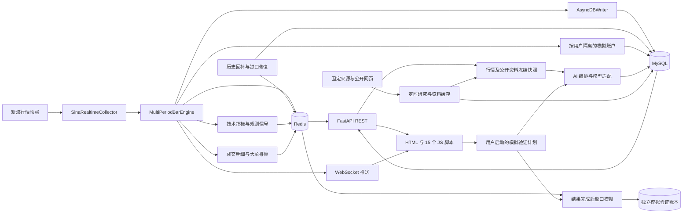

# 项目架构与 AI 导航

更新日期：2026-10-22（北京时间）。项目根目录：`D:\期货实时交易系统`。

开源交付入口为根目录 `LICENSE`、`THIRD_PARTY_NOTICES.md`、`CONTRIBUTING.md`、`SECURITY.md` 及 README 的首次运行说明。公开仓库以独立源码快照发布，不携带私有历史、厂商 SDK、采集证据原文和运行凭据；原始材料仍保留在本机与私有备份。公开化仅修改交付文档与仓库元数据，不改变服务架构、运行配置或冻结 CTP 模块。历史证据的本机路径不保证在公开版存在。

本文依据当前源码整理，用于快速定位代码。核对基线的 Git HEAD 为 `4725259`（当时前端拆分为 13 个脚本），随后在工作区新增了本文所述 Codex MCP 接入及第 14 个模拟验证脚本；后续以实际源码、配置及用户指令为准。本文不是实时运行状态或验收报告。未读取、检查或修改冻结的 CTP 模块内部实现。

## 1. AI 首次进入项目的阅读顺序

1. 先读根目录 `AGENTS.md`：开发边界、服务重启和测试约定。
2. 读本文第 2、3、8 节，判断任务属于哪个模块；不必扫描整个仓库。
3. 只读任务对应的入口、上下游和相关测试。跨模块修改再扩展范围。
4. 要了解某次功能验收，查看第 10 节对应报告；报告中的合约、时间和统计数字仅代表原时点。
5. 每次新增、修改、删除或重命名系统文件后，检查是否影响 `AGENTS.md` 的说明与约定，涉及内容必须在同一次改动中同步维护。影响架构、模块职责、数据流、入口、数据表、脚本加载顺序或运行方法时，同步更新本文；README 相关说明或链接受影响时也一并更新。完成前核对文件路径和命令。

默认用中文协作。敏感配置、账号密码、模型密钥不复制到文档、记忆或工具输出。

### 功能规格与实施导航

2026-10-22 AI盘时段误拦修复：`snapshot.py:build_snapshot()` 在完成小节/盘前上下文选择后，对实际发送的 `market.bars_1m` 执行质量检查，避免上午采集缺口拦截下午健康小节；TODAY/NEXT_OPEN 全天口径保留。`market_quality()` 返回 `unverified_volume_bars` 定位信息，第9脚本在结果审计区用文本展示。未知分钟量与报价新鲜度门槛保留，历史快照不重写。回归为 `tests.test_ai_reliability`、`tests.test_ai_analysis`、`tests.test_volume_quality` 和 `node tests/check_ai_reliability.cjs`；真实冻结数据及验证见[修复审计](audits/2026-10-22-AI-session-quality-scope.md)。

2026-10-21 Phase 9成交量修复：`backend/common/volume_quality.py`统一跨采集缺口的不可分配分钟量。采集保留差分原始区间而不归到单分钟，质量随闭合/高阶继承；历史价格修复保留标记。API返回null+volume_raw；指标、实际量比样本、正式规则及AI不采用未知量；图表取消分位数削峰并明确未知空点。`scripts/quarantine_volume_allocation.py`仅做有证据的显式维护，保留原值和来源、写完整审计、WATCH只同步质量。实际处置见`docs/audits/2026-10-21-FU2701-volume-gap.md`，专项`tests/test_volume_quality.py`及`tests/check_volume_quality.cjs`；Phase 8/9后共64项任务。

2026-10-21 Phase 8来源修复：`backend/common/bar_evidence.py`为纯源报价证据/历史时间网格模块。新浪bar engine的新检查点保存上一真实源报价及周期前一分钟内的原始累计量观测、源时间和哈希；旧状态不补造，非交易所精确边界，仍为PARTIAL。模拟器reader新建基准只读新浪15m/60m原始历史，按日/夜各自累计交易分钟生成start/end/segments，保留END源标签及UNKNOWN覆盖；不混合本机高阶柱、不回写历史，1m仅核验当前15m窗口。API在取数完成后刷新冻结时间并重验新鲜度；失败不回退旧缓存。新增专项`tests/test_simulator_source_evidence.py`覆盖源记录→检查点重启→HTTP创建/模拟/释放及负例。Phase 8时共59项任务，真实来源与人员验收状态以功能目录acceptance.md为准。

行情模拟器 Phase 7（T047～T053已完成，48/54项；来源与人员验收待完成）保持原模块入口：reader 负责源记录422校验（含已知总持仓非负、未知持仓保留）与质量摘要，service 保持 Decimal 整数手计算，15脚本对快捷场景采用服务端成功后提交草稿，并区分本次失败与上次成功输入。真实来源和人员验收独立记录在功能目录 acceptance.md，缺anchor不放行。

- Spec Kit 基础设施为 `.specify/` 与 `.agents/skills/`，功能文档位于 `specs/`；当前功能路径由 `.specify/feature.json` 保存。初始化宪章仍是未填写模板，协作边界沿用 `AGENTS.md`。
- [行情模拟器 V1 规格](../specs/001-market-simulator/spec.md)：固定15分钟假设收盘情景、冻结基准、规则比较及固定参考计划的毛收益风险比；[技术方案](../specs/001-market-simulator/plan.md)、[实施任务](../specs/001-market-simulator/tasks.md)、[研究](../specs/001-market-simulator/research.md)、[数据模型](../specs/001-market-simulator/data-model.md)、[契约](../specs/001-market-simulator/contracts/market-simulator.md)、[验证指南](../specs/001-market-simulator/quickstart.md)、[需求质量清单](../specs/001-market-simulator/checklists/requirements.md)。2026-10-19完成规格、方案、45项待办任务及[五项一致性修订复核](../specs/001-market-simulator/checklists/analysis-remediation.md)，现已实施独立模拟抽屉和三端点（`backend/market_simulator/`、`backend/api/market_simulator_routes.py`、`frontend/js/15-market-simulator.js`），不新增数据表；验收状态见[acceptance.md](../specs/001-market-simulator/acceptance.md)；不等同于已有模拟行情源或AI模拟验证账本。

## 2. 项目概况

这是国内期货行情分析与模拟交易系统，包含实时行情、多周期 K 线、技术指标与规则信号、模拟账户，以及 AI 分析和定时公开资料研究。当前 Windows 启动脚本固定 `FUTURES_PROFILE=local`，`config/settings.yaml` 的行情源为 `sina`。这些是启动脚本和配置事实，实际进程环境仍需现场核查。

| 层次 | 技术与职责 |
| --- | --- |
| 服务 | Python 3.11、FastAPI、Uvicorn，默认单进程；REST、页面和 WebSocket 由同一应用提供 |
| 前端 | 原生 HTML/CSS/JavaScript；TradingView Lightweight Charts 4.1.3；主工作台按顺序加载 15 个普通脚本 |
| 数据模型 | Pydantic 行情对象；SQLAlchemy ORM |
| 即时缓存 | Redis：最新报价、近端 K 线、规则信号、订阅和盘口推算数据 |
| 持久化 | MySQL 8.0、PyMySQL：历史行情、模拟账户状态、AI 任务与公开资料 |
| 后台执行 | 行情采集线程、批量写库线程、历史回补线程、串行资料研究线程、AI 线程池及 asyncio 周期任务 |
| 独立采集 | `data_collection/`：独立 CLI、SQLite 存储、仓单及日行情采集，不由主服务启动 |
| 交付方式 | Windows 批处理/桌面控制台；另有 Docker Compose 与便携部署目录 |
| Codex 接入 | `codex_mcp/`：由 Codex 按需启动的独立 stdio MCP 进程，通过本机 GET API 读取新浪研究行情，SDK 使用 `.venv-mcp/` |

这是单体应用配后台工作线程，不是前后端分离的 SPA，也没有独立的 Celery/消息队列服务。内存中的账户、K 线引擎、线程池和 WebSocket 连接属于当前进程；不要直接改成多个 Uvicorn worker。

Codex 只读 MCP 适配器是独立进程，不改变主服务的单进程架构，也不启动主服务。接入、工具参数和质量边界见 `docs/Codex只读行情接入.md`。

## 3. 总体数据流



### 行情与历史

- `sina_collector.py` 批量轮询、解析、去重，生成 `TickData`，交给 `MultiPeriodBarEngine.on_tick()`。
- `fetch_sina_quotes()` 用独立 `ProxyHandler({})` 直连新浪实时快照，避免继承系统代理后出口被拒（403）；保留HTTPS校验和原请求头/超时/分批，不更改全局代理或其他模块连接器。定向回归：`tests.test_sina_parser`；排障分别核实HTTP成功、采集状态和源盘口时间，休市静态报价不能当实时更新。
- K 线引擎更新报价、生成 `1m/5m/15m/30m/60m/1d`，将行情入写库队列，同时驱动模拟账户、成交推算和 WebSocket。
- 15 分钟 K 线闭合回调触发 `SignalEngine.evaluate_15m_signals()`；规则会使用 15 分钟及 60 分钟历史。
- 1分钟历史仅用新浪（2026-10-15）：`backend/storage/history_backfill.py:repair_minute_gaps()` 的启动、订阅及周期补缺均停用东方财富备用请求，返回 `fallback_skipped=DISABLED`；新浪失败向上抛错，无数据保留真实缺口。既有东方财富历史与字段来源保留，新浪修正价位时仍保留既有真实成交量/成交额，AI继续提示 `FALLBACK_1M_SOURCE_EASTMONEY`。`eastmoney_history.py` 及备用内核仅保留为历史兼容代码，不接入运行补缺。回归：`.venv\Scripts\python.exe -m unittest tests.test_eastmoney_history tests.test_bar_provenance tests.test_ai_reliability tests.test_trading_time tests.test_startup_backfill`；原补缺用发现模式 `test_minute_gap_repair.py`。
- `POST /api/v1/watchlist` 的回补使用 `ensure_symbol_backfilled(symbol, full_history=True)`，覆盖主连符号；全量指源端实际能返回的各周期历史，不能承诺无限历史。
- 行情 API 合并 MySQL 历史与 Redis 近端。来源和变换信息随 `provenance_json` 保留。

### 模拟交易

- API 根据登录用户名调用 `paper_accounts.get(username)`。
- 一个 `PaperAccount` 组合撮合、硬风控、条件止损止盈和规则跟单；状态事务含版本校验，持久化到 MySQL `trading_state`。
- 行情 Tick 驱动需要该合约的模拟账户。取消页面订阅不应丢掉已有持仓、挂单和条件单所需的行情。
- AI 分析结果是研究输出，不接入下单、撤单或跟单执行。模拟规则跟单有自己的模块和开关。

### AI 分析

- 前端提交 `POST /api/v1/ai/analysis/{instrument}`，`client_request_id` 用于按账户防重复创建。
- `snapshot.py` 冻结合约、目标、行情质量、已闭合 K 线等输入；未来趋势还冻结公开资料。批次保存快照与 hash，每个模型对应一个 run。
- 未来趋势新建分析时，`snapshot.py:_load_future_bars()` 经 `history_backfill.py` 的只读新浪抓取函数分别读取日线/60m/15m原始历史序列，不写库或缓存，不合并本机 START 时间标签的实时合成柱。按冻结截点筛选已闭合柱后保留原 DAILY_CLOSE/END 标签及来源信息，仍标明源覆盖 UNKNOWN；`quality.market_checks.series_selection=SINA_HISTORY_ONLY`。某周期请求失败保留 `HISTORY_FETCH_FAILED_*` 与数量/连续性阻断，不用部分覆盖缓存冒充成功；历史结果 GET 不请求历史接口、不改写快照。盘中/模拟验证取数流程保持原路径。
- `market_quality()` 按已闭合 1 分钟柱的结束时间判断新鲜度：`START` 标签加 1 分钟，`END` 标签直接使用，旧数据沿用开始标签默认口径。连续交易时闭合后超过 2 分钟触发 `STALE_1M_BARS`；开盘/小节恢复前 2 分钟保留宽限，报价过期和分钟缺口另行检查。回归覆盖见 `tests/test_ai_reliability.py`。
- 分钟缺口按 `trading_time.py:is_trading_time_for()` 的左闭右开交易小节判断，上午最后一根开始标签为 11:29，11:30 收盘边界不算缺失分钟；商品、股指和国债的午休边界及真实分钟缺口由 `tests/test_ai_reliability.py` 回归覆盖。
- `orchestrator.py` 用当前 3 个 worker 的线程池调度模型调用，保存请求、响应、复核、追问和错误；`provider.py` 负责 OpenAI 兼容/Gemini 请求与结构验证。
- 目标枚举：`TODAY` 今日走势、`CURRENT_SESSION` 当前小节、`NEXT_OPEN` 下一开盘小节、`FUTURE_TREND` 未来趋势。未来趋势目标为按交易日计算的 3 日和 5 日。
- 行情不足、期限或引用不合格时可能阻断。执行状态、实际调用次数、发布状态分别判断：`SUCCEEDED` 不能单独证明模型调用成功或预测可用；还要看 `call_count`、`publication_status`（如 `REVIEWED/DRAFT_ONLY/BLOCKED`）。
- 数值证据必须与冻结行情的时间、原始字段和值一致；`trend_context` 等派生背景仅作文字说明。`provider.py` 的 `EvidenceValidationError` 包含失败项，`orchestrator.py` 对每票失败草稿最多追加一次 `CORRECTION`，携带同一冻结输入及原输出，检查上下文预算并重新严格校验；纠正仍失败时不发布该草稿。前端将无有效结果的 `UNSTRUCTURED` 显示为“结果校验失败，未进入复核”。
- 前端轮询 batch/run 展示结果；`settlement.py` 按实际后续行情自动评分，人工评分优先。复盘总结可作为后续任务上下文，使用内容会再次冻结。
- 盘中 `CURRENT_SESSION` 由 `session_window.py:chart_for_completion()` 按每个模型实际完成秒生成10分钟窗口，先收盘截到小节结束。冻结前证据范围保持不变，`evidence_cutoff_time` 与 `session_end_time` 保留；API旧盘中图表只读转换，既有评分和模拟终态账本不改写。`settlement.py` 仅用完整分钟柱验证触发后目标/失效，同柱先后不明或窗口分钟缺失不伪造命中；到期方向评估用分钟采样，和独立模拟账本的真实盘口盈亏分开。`ACTUAL_NET` 已成交新活动记录以交易净收益减本次模型费用判断胜负，未知费不判，持平仍参与评估分母并打断连亏。
- `CURRENT_SESSION` 同时支持盘中预测线与未开盘小节的盘前展望线。`snapshot.py` 为盘前冻结 `session_forecast.kind=PRE_OPEN`、所选开收盘窗口、盘前参考价/时间及目标交易日；模型返回目标/失效/可选触发价，`orchestrator.py` 规范价位并强制使用冻结窗口。`06-ai-session.js` 在分时图补齐该小节的分钟留白、显示基准/触发/目标/失效线及“等待开盘”，只使用所选窗口内行情判断触及。历史查询按盘前目标交易日，原报价交易日仍保留；旧记录不会自动补画线，需要重新生成展望。中性/无法判断结果只保留基准线，不编造方向价位。验证为 `node tests/check_ai_session_lines.cjs` 和 `.venv\Scripts\python.exe -m unittest tests.test_ai_analysis`，浏览器及真实模型输出需单独验收。

### AI 盘时段独立模拟验证 / 自动模拟盘

- 新浪延迟盘口修复（2026-10-15）：行情引擎只在接纳新源时间 Tick 时给新浪缓存写 `received_at`，重复源报价不刷新接收时间。活动 AUTO_PAPER 的 `quote_policy=SINA_SOURCE_30S_RECEIPT_10S` 允许源延迟最多30秒、接收后最多10秒；缺接收时间的旧缓存沿用10秒源时间上限，其他模拟验证模式仍为原10秒。模型完成时间、进场截止、交易日和买卖价边界保留，`mark_position()` 与成交同策略。新计划冻结该策略，当前活动记录由扫描写策略，旧终态和旧配置不回写。未成交 state 的 `quote_diagnostics` 保存最后校验、拒绝次数和有效期内被拒触线证据；页面据此区分价格未触发、缺少有效盘口和触线被拒，历史无诊断仅显示未成交、原因未记录。测试增加 `tests.test_bar_provenance`。
- 自动模拟盘规则1.5：新建默认使用5分钟未触发重试，10分钟持仓强平仍从模型完成起算；`entry_deadline_at` 与 `position_deadline_at` 分离。当前运行的Gemini结果驱动计划可显式 `upgrade_auto_paper_rules()`，保留历史终态/成交、持仓价位、模型配置及提示词；迁移只改配置与活动截止，不发模型请求。AUTO_PAPER 未成交重试/进场前失效不计交易胜负，仍扣实际模型费用；旧终态统计保留。
- `get_report()` 读取所属计划的新鲜同交易日新浪盘口，调用纯函数 `mark_position()`，返回 `live` 与逐笔 `live_pnl`；多仓按买一、空仓按卖一，加不利滑点/双边手续费。持仓交易净估值加已实现账本（含模型費）得到预计合计，未知費或旧报价不伪装已知实时净收益；只读估值不落成交账本。`14-ai-verification.js` 每2秒显示实时持仓/浮动收益/预计合计及报价时间；已实现统计保持独立，模型选择优先Gemini。

- 计划报告新增 `activity`：`paper_verification.py:_plan_activity()` 根据实际账本、重试时间与交易日历只读计算当前动作、下一步、预计/截止北京时间和待结费用；不会派发任务或调用模型。`14-ai-verification.js` 在 `index.html` 顶部活动卡显示，随现有每 2 秒报告刷新更新并沿用过期请求隔离，切换计划清空旧状态。休盘/首次分析时间按日历列出，末 5 分钟不展示该段重试为可执行分析，已超时未处理和缺行情结算单独标明。
- 调度统一以小节结束前 5 分钟为新分析截止时间（截止点包含在停止区间）：固定及结果驱动窗口均在截止前，实际提交再检查扫描时间。该限制对当前运行计划直接生效；末 5 分钟不算新的应监测/漏分析窗口，历史已有记录保留。已提交分析和已有持仓继续处理结果、费用及结算。
- `TRADE_OUTCOME` 已持仓记录从模型完成时间起满 10 分钟仍未止盈/止损，内核以截止后的首笔新鲜盘口结算，退出原因 `RESULT_TIMEOUT`；服务随后继续分析。ACTUAL_NET 新记录胜负按实际交易净收益减本次模型费判断，历史已结束记录保留原规则；金额保留真实交易损益、滑点、手续费和模型费用；缺当前报价等待，不倒推成交。该规则用于仍在执行的持仓，不改写历史已结束账本。
- 报告胜负包含已核实平仓交易（排除收盘提前结算）、`SIGNAL_TIMEOUT` 及 `PRE_ENTRY_INVALIDATED` 亏损；未成交记录仅扣已知分析费用，不虚构交易损益。`SESSION_END_EARLY` 单列，保留金额而不计胜负；`is_early_session_settlement()` 也识别历史 `SESSION_END` 的短观察窗口，不改写账本。无有效分析结果及模型请求超时不计胜负。连亏按退出/信号截止/失效观测时间排列，平均交易收益仍按全部已核实平仓交易计算。恰好 10 分钟截止的报价先判断止盈/止损，迟于截止的仍超时结算；缺报价持仓保留 `settlement_pending`，前端显示“已超时，待报价结算”及对应数量。逐次分析与逐笔成交按分析时间倒序展示。
- 模拟用户通过 `POST /api/v1/ai/verification/plans` 显式启动计划；GET 列表和报告不会启动分析。一个账户最多一个运行或停止中的计划。
- `main.py:verification_loop()` 每 2 秒调用 `paper_verification.tick()`；固定每个小节开盘 15 分钟后开始；明确方向返回后等待行情或模拟交易结果，AUTO_PAPER 未成交信号从模型完成起 5 分钟未触发作废重试；持仓退出后再分析，无明确方向或无有效结果等待 5 分钟，实际发起满 10 分钟未返回作废后重试，收盘停止。发起单模型 `CURRENT_SESSION` 分析，复用 `ai_routes.create_analysis_for_owner()` 的冻结快照、容量门槛和凭据处理。
- 合约、模型公开配置 hash、手续费/滑点、模型人民币价格与 1 手/20 实际交易日规则随计划冻结。小节记录先落库，使用 trial UUID 作为分析请求 ID，重启后恢复已有批次，不重发错过的窗口。
- `paper_verification_engine.py` 仅基于模型完成之后的新鲜 `quote:sina:{instrument}` 盘口模拟一仓；成交价计入不利滑点，费用单列手续费及全部分析调用费用。方向不足、校验不合格、模型费用未知和结束缺盘口分别保留原因，不能视作零成本盈利。
- 独立表 `ai_paper_verification_plan` 与 `ai_paper_verification_trial` 不写 `trading_state`，不调用现有模拟账户下单 API，不涉及 CTP，不自动订阅合约或回补行情。启动后关闭浏览器仍由主服务运行；停服务期间不倒推成交。
- 入口为右侧“模拟验证”和 `14-ai-verification.js`；报告包含逐次分析、日汇总、交易净收益、模型费用、合计净收益、已实现回撤/连亏及完整度。`renderAIVerificationTrials()` 展示 7 列概要与整行展开详情，完整时间/价位/费用/追踪编号均保留；`appendAIVerificationAIResult()` 展示持久化 AI 结论、证据完整度（非胜率）、条件、风险、行情证据及草稿/复核状态。报告 `get_report()` 批量查询所属账户、同合约/模型的结果，通过 `_ai_result()` 白名单返回，不含配置、请求或原始响应；读取不创建任务或调用模型。打开时每 2 秒独立刷新报告，计划列表与报告分别防重叠；读取禁用缓存、10 秒超时，失败保留旧结果并重试，轮询保留展开状态与滚动位置，显示最近更新时间；`index.html` 用限定样式统一面板纵向滚动、窄屏表格横向滑动。触发价须位于冻结参考价的待突破一侧；未成交边界由成交内核按报价时间处理，停止取消优先于超时判亏。创建与报告文案均说明从模型完成起10分钟持仓结算规则。详细规则与人工验收见 `docs/2026-10-08-AI模拟验证使用与验收.md`。

### 公开资料研究

- 同品种共享缓存：`research_cache.py:_collection_group()` 将分析合约匹配到已配置的同品种采集目标，精确合约优先；例如只配置 FU2611，FU2701 也可引用 `product:FU` 品种资料和公共宏观缓存。具体月份资料继续按 `scope=contract` / `applicable_contracts` 限制，冻结时保留账户隔离、到期状态、截点及有效期。状态接口为当前合约返回共享缓存与覆盖信息，前端 `08-ai-research.js` 标明共享品种，手动更新使用已配置目标；不改变采集设置，不增加自动任务或模型调用，不恢复跨品种关联。
- `research_scheduler.py` 是主服务内的串行工作线程，顺序为固定来源检查 → 固定关键词搜索 → 按条件触发 AI 辅助。
- 定时研究设置、任务、资料按账户存储；研究采集模型与分析时选择的模型有各自入口。
- `research_cache.py` 管理任务和资料版本、来源统计、手工录入、查询导出，以及预测时的资料冻结。
- `fixed_research.py`、`web_research.py`、`dce_api.py` 负责固定来源、网页搜索/正文提取、官方仓单协议。通道是否启用由 `channel_policy.py` 和 `config/research_channels.json` 控制。
- 当前关联合约参考功能已移除；新预测不读取关联品种资料或关联行情，旧冻结输入保留。`related_markets` 资讯维度仍存在，与关联合约功能不同；残留辅助函数不能当作功能仍启用的证据。
- 原文、原单位、发布时间、统计期、获取时间、来源与验证状态分开保存。仓单不等于全库存；转载网站不自动等于原始发布机构。

## 4. 后端代码地图

以下路径均相对于项目根目录。

| 入口/模块 | 主要职责与定位 |
| --- | --- |
| `run.py` | Windows 服务入口，`backend.main:app`，监听 `127.0.0.1:8000`，`reload=False` |
| `backend/main.py` | 生命周期接线：初始化数据库、恢复中断任务和模拟账户、启动行情与各后台任务，退出时停止 |
| `backend/api/routes.py` | FastAPI 对象、行情/订阅/分组/模拟交易/盘口/维护 API，以及 HTML 和 `/js/{filename}` 服务 |
| `backend/api/auth.py` | Cookie 登录、账户角色与访问门禁 |
| `backend/api/ai_routes.py` | 模型配置、分析批次、结果历史、评分、追问、复盘、研究设置及资料查询 |
| `backend/api/paper_verification_routes.py` | 独立模拟验证计划的创建/列表/报告/停止；模拟角色和账户隔离 |
| `backend/api/tools_api.py` | 登录后使用的只读工具 manifest、报价/K 线/信号/解释 |
| `backend/common/config.py` | YAML 配置、profile、dotenv、环境覆盖、CORS 和会话密钥 |
| `backend/common/trading_time.py` | 交易日、节假日、夜盘归属与品种交易小节；年度日历须随时间维护 |
| `backend/common/bar_evidence.py` | 纯新浪原始累计量观测边界与哈希核验、历史交易分钟END网格；不访问存储或网络 |
| `backend/common/product_specs.py` | 品种、交易所、合约乘数及代码转换等共用定义 |
| `backend/collector/sina_collector.py` | 实时快照采集、解析、订阅清单、状态 |
| `backend/bar_engine/bar_engine.py` | 分钟与多周期/日线合成、恢复、收盘、缓存、模拟 Tick 分发 |
| `backend/indicator_engine/indicators.py` | 技术指标计算 |
| `backend/indicator_engine/realtime_analyzer.py` | 实时量价、结构与买卖点分析；与大模型分析分开 |
| `backend/indicator_engine/replay.py` | 规则信号后续表现统计；CLI 入口见 `scripts/replay_analysis.py` |
| `backend/signal_engine/signal_engine.py` | 客观规则信号、数值证据和缓存 |
| `backend/storage/universe_sync.py` | 全市场合约元数据同步、合约代码规范化与缓存 |
| `backend/storage/history_backfill.py`、`eastmoney_history.py` | 新浪历史抓取及全量/增量补缺；东方财富备用已停用，仅保留历史兼容代码及来源记录 |
| `backend/storage/db_writer.py` | 内存队列、工作线程、行情批量入库 |
| `backend/storage/mysql_client.py` | SQLAlchemy engine/session、建表及部分幂等补列；测试可重绑定库 |
| `backend/storage/redis_client.py` | Redis 单例客户端，`protocol=2`，空密码不发 AUTH |
| `backend/storage/retention.py` | Tick 保留期清理与每日调度 |
| `backend/models/market_data.py` | `TickData/BarData/SignalData` 及序列化 |
| `backend/models/database.py` | ORM 表结构，配合 `migrations/`；冻结表内部不纳入通常审查 |
| `backend/trade_engine/paper_accounts.py` | 按用户名管理模拟账户、事务、启动恢复及行情需求 |
| `backend/trade_engine/paper_trader.py`、`risk_manager.py` | 模拟撮合与事前硬风控 |
| `backend/trade_engine/stop_engine.py`、`signal_bridge.py` | 模拟条件单和规则跟单 |
| `backend/trade_engine/state_store.py` | 交易状态的同步持久化和版本校验；修改共享文件时不扩展到 CTP |
| `backend/tape/tape_recorder.py` | 相邻快照差分形成的成交明细、大单及方向推算，不能当逐笔真实成交 |
| `backend/websocket/routes.py`、`manager.py` | 连接认证、按 feed 分发和线程安全推送 |
| `backend/notifier/notifier.py` | 系统事件、落库、页面通知和可配置 webhook |
| `codex_mcp/server.py`、`market_client.py` | 本机 Codex MCP 工具、固定 GET 行情查询、闭合/时间/来源及局部缺口提示；独立环境 `.venv-mcp/` |

### AI 子模块

| 文件（`backend/ai_analysis/`） | 职责 |
| --- | --- |
| `registry.py`、`credentials.py` | 按账户注册模型与配置校验；API Key 存 Windows Credential Manager，库中保留凭据引用 |
| `snapshot.py` | 行情快照、当前小节/下一开盘/未来趋势上下文、连续性和质量门槛 |
| `orchestrator.py` | 后台分析、模型投票/复核、上下文预算、任务状态、追问和复盘编排 |
| `provider.py` | 模型 HTTP 适配、地址策略、错误净化和结构校验 |
| `future_trend.py` | 未来目标日、合约期限、公开资料归一化、来源/引用和结果校验 |
| `research_scheduler.py` | 定时研究队列、租约、恢复、固定与 AI 阶段执行 |
| `research_cache.py` | 设置、资料版本、任务状态、来源占比、导出和冻结 |
| `fixed_research.py`、`web_research.py`、`dce_api.py` | 固定源与规则搜索、网页正文/AI提取、DCE 官方协议 |
| `channel_policy.py` | 共用自动采集通道开关；启用状态不等于实际采集成功 |
| `settlement.py`、`alerts.py` | 到期评分和限频告警 |
| `paper_verification.py`、`paper_verification_models.py` | 用户启动的 20 交易日模拟验证调度、两张独立账本表、分析恢复和成本追踪 |
| `session_window.py` | 盘中模型完成后10分钟窗口、证据截点保留、UTC转北京与收盘裁剪；盘前窗口不变 |
| `paper_verification_engine.py` | 纯函数：结果可用后盘口模拟、退出、净收益/回撤/连亏/日汇总 |

## 5. 前端定位

`frontend/index.html` 是工作台的 HTML/CSS，`/paper` 使用它。主服务提供 `/js/{filename}`，HTML/JS 使用 `Cache-Control: no-store`。脚本在 HTML 中按下面顺序加载，共享全局状态和函数；它们不是 ES module，不能随意调整顺序或改成 `async`。

| 脚本（`frontend/js/`） | 优先查找的功能 |
| --- | --- |
| `01-core.js` | 共用状态、变量、基础工具 |
| `02-chart.js` | 主图、分时、K 线、坐标和图表交互 |
| `03-contracts.js` | 合约搜索、关注列表、分组、排序和切换 |
| `04-subchart.js` | 成交量/持仓等副图 |
| `05-data.js` | 行情/历史数据加载与刷新 |
| `06-ai-session.js` | 当前小节 AI 及图表参考线 |
| `07-ai-models.js` | 模型配置、密钥和连通性操作 |
| `08-ai-research.js` | 定时研究设置、资料采集/查询、来源与覆盖显示 |
| `09-ai-analysis.js` | 分析提交、轮询、历史、未来趋势、评分、追问和复盘；首页右侧 AI 结果每 2 秒只读刷新 |
| `10-tape.js` | 成交推算和大单列表 |
| `11-websocket.js` | 连接、重连与推送处理 |
| `12-trading.js` | 模拟账户、委托、条件单、资金曲线等交易交互；共享处保留冻结边界 |
| `13-boot.js` | 页面初始化、事件和启动接线，启动首页 AI 结果自动刷新 |
| `14-ai-verification.js` | 独立模拟验证创建/冻结配置、停止、报告轮询与 JSON 导出；只在弹窗打开时轮询 |

模拟验证停止结清为 `STOPPED` 后，可通过 `POST /api/v1/ai/verification/plans/{plan_id}/resume` 重新启用。保持原20个交易日周期和冻结参数，`resume_history` 记录停止/恢复时间，`schedule_history` 分段计算原运行范围；停止区间不补发分析或成交，也不计漏分析。恢复前检查所有记录已结清、没有其他活跃计划、模型配置 hash 一致及周期未结束；已完成须新建。后续首次有效窗口继续调度，旧结果重试不会复活。

模拟验证默认提示词以本次分析冻结时刻及所选连续交易小节为证据边界，预测窗口使用冻结的 `session_forecast`；允许参考小节内历史支撑压力，冻结前突破不能算触发或预测命中。默认文案更新不覆盖已保存的计划配置。模拟验证计划在 `config_json` 保存独立 `analysis_requirements`，创建和 `dispatch_analysis()` 使用该提示词；旧计划回退到默认要求。所属用户仅可在计划已结清且状态为 `STOPPED` 时通过 `PATCH /api/v1/ai/verification/plans/{plan_id}/requirements` 更新后续分析，其他状态返回 422；`requirements_history` 留存旧要求与修改时间，历史分析快照保持原文。页面深色提示词卡片按计划状态锁定，锁定时允许复制；已停止的编辑草稿不被自动报告轮询覆盖，重新启用前必须保存修改。新建计划提示词可编辑。手续费必填，滑点和模型输入/输出价格默认 0，允许显式覆盖，旧账本和旧成本不改写。

AI 默认分析要求定义在 `08-ai-research.js` 的 `aiAnalysisRequirementDefaults`，由 `09-ai-analysis.js:syncAIAnalysisTarget()` 加载浏览器保存值。盘时段的 `aiSessionRequirementDefaults` 分别定义 `UPCOMING` 盘前要求与 `ACTIVE` 盘中要求；`syncAISessionSelection()` 随所选小节状态切换默认文案，只显示对应状态要求。打开分析弹窗及切换小节时迁移与旧默认文案（含原盘前盘中混合文案）完全一致的保存值，自定义要求保留。相关回归为 `node tests/check_ai_intraday_date.cjs`。

`frontend/login.html` 为登录页。`frontend/live.html` 是保留的正式登录一体页面，属于冻结范围的相关入口；当前 local 模式不开放。`/live` 的工作台路由实际复用 `index.html`，不要仅凭文件名推断路由关系。

## 6. 存储与配置

### MySQL

| 类别 | 关键表 |
| --- | --- |
| 行情与元数据 | `instrument`、`market_tick`、`market_bar`、`signal_record` |
| 模拟状态与事件 | `trading_state`、`account_snapshot`、`system_event` |
| 模型配置 | `ai_model_config`、`ai_model_test_log` |
| AI 分析 | `ai_analysis_batch`、`ai_analysis_run`、`ai_analysis_call`、`ai_analysis_evaluation`、`ai_analysis_follow_up` |
| AI 独立模拟验证 | `ai_paper_verification_plan`、`ai_paper_verification_trial` |
| 复盘记忆 | `ai_analysis_review_summary`、`ai_analysis_review_usage` |
| 公开资料研究 | `ai_research_settings`、`ai_research_job`、`ai_research_material` |

`market_bar` 按 `(instrument_id, period, bar_time)` 唯一；资料按账户、URL hash 与正文 hash 区分版本。AI batch 按账户和请求 ID 唯一。交易状态键使用 `paper:{username}`；研究及模型必须保留账户隔离。

模拟验证 trial 按 `(plan_id, analysis_due_at)` 唯一，配置及成交/费用状态保存在各自 JSON 字段。`init_db()` 先导入 `paper_verification_models.py` 再建新表，幂等将旧 trial 的小节唯一索引改为分析时间唯一索引，无须改变现有交易表。新计划冻结 `analysis_schedule_mode=RESULT_DRIVEN`、`analysis_timeout_minutes=10`、`no_direction_retry_minutes=5`、`analysis_result_trigger=TRADE_OUTCOME`、`signal_timeout_minutes=5`、`position_timeout_minutes=10`、`execution_mode=AUTO_PAPER`、规则版本 1.5、`outcome_policy=ACTUAL_NET`；旧计划保留原频率。调度窗口键按数据库 DATETIME(0) 向上取整到秒，实际提交及10分钟截止保留原精度。trial JSON 持久化实际提交/超时截止/后续分析时间与作废/费用追踪状态，超时迟到结果只计费，不恢复方向；停止后追踪未结模型费用。`upgrade_trade_outcome_schedule()` 显式切换运行计划，作废旧待返回/未成交信号、保留历史费用和持仓；`schedule_history` 保存显式规则切换前的时段配置，动态应监测范围由每小节首次窗口、已持久化后续分析时间和既有记录共同计算，不编造离线期间的连续分析。新结果使旧的未成交信号失效，已持仓保留原目标/失效价与退出规则。

`init_db()` 包含 `Base.metadata.create_all()` 和有限 `_ensure_columns()`，同时保留 Alembic `migrations/versions/`。自动建表不等于所有旧库结构已升级，新增字段要核对模型、迁移、补列路径和实际库。

### Redis

| 键族 | 内容 |
| --- | --- |
| `quote:sina:{symbol}` / `quote:{symbol}` | 最新报价与兼容键 |
| `bar-engine:forming:sina` | 形成柱及新浪最新原始源报价/15m周期前累计量边界证据；仅采集分支写入，模拟读取不修改 |
| `bars:{symbol}:{period}` | Sina 近端 K 线缓存 |
| `signal:{symbol}` | 最新客观规则信号 |
| `watchlist:subscribed`、`watchlist:order`、`watchlist:groups`、`watchlist:group_order`、`watchlist:names` | 共享订阅清单、分组、排序、别名 |
| `universe:contracts` | 全市场合约元数据 |
| `feed:status:sina` / `feed:status` | 行情采集状态 |
| `history:rebuild:symbols` | 待重建的历史合约 |
| `tape:{symbol}`、`bigorders:{symbol}` | 快照推算记录 |

关注清单是当前共享 Redis 配置，不能因为交易/AI按用户隔离就假设订阅也按用户隔离。Redis 为业务缓存与部分运行状态，不是 AI 队列的消息代理。

### 配置文件

- `config/settings.yaml`：local 主配置；`settings.simnow.yaml/settings.prod.yaml` 为其他 profile，冻结边界仍适用。
- 配置优先级：真实进程环境 > `.env.<profile>` > `.env` > YAML；`FUTURES_PROFILE` 选择档案。
- `config/instruments.yaml`：初始合约/规格；`config/signals.yaml`：规则配置；`product_specs.py` 也有共用品种规格，改规格时核对消费点。
- `config/users.yaml`：用户名、角色、密码 hash；`security.py` 实现密码校验和 HMAC 会话，`auth.py` 设置 HttpOnly Cookie。
- `config/research_channels.json`：自动采集通道政策；`config/future_contract_rules.json`：未来目标期限规则与证据引用。
- `.env*`、`config/session_secret.key`、Windows Credential Manager：敏感凭据位置，不在架构文档保存实际值。
- Linux/Docker 不应假设能直接复用 Windows Credential Manager 中的模型密钥；支持边界先核对 `credentials.py`。

## 7. 独立 `data_collection/` 的边界

入口：`python -m data_collection.cli --config <配置路径> <命令>`；命令包括 `run/backfill/self-check/schedule`。

组成：`config.py` 配置与日历 → `scheduler.py` 日期/断点/任务调度 → `collectors/` 请求解析校验 → `transport.py` 网络限流重试 → `validators.py` 数量勾稽/参考对账/单位校验 → `storage.py` SQLite 幂等写入。

SQLite 表为 `receipt_market`、`collection_log`、`variety_mapping`。仓单聚合取 `TOTAL`，行情聚合取 `MARKET`；不可将明细、集团和总计重复累加。原值与吨值分列，没有可靠换算依据时吨值留空。

该模块不由 `start.bat` 启动，不连接主服务 MySQL，不接入现有页面。线上源默认关闭，MySQL 适配尚未实现。真实来源与离线样例边界见 `data_collection/README.md` 和 `acceptance.md`；独立模块离线测试不代表全交易所生产采集可用。

## 8. 按任务快速找文件

| 任务或现象 | 优先读源码 | 对应测试例子（`tests/`） |
| --- | --- | --- |
| 报价、休市、交易日错误 | `sina_collector.py`、`trading_time.py`、`05-data.js` | `test_sina_parser.py`、`test_trading_time.py`、`test_market_improvements.py` |
| 订阅/主连历史不全 | `routes.py:add_watchlist`、`history_backfill.py`、`03-contracts.js` | `test_startup_backfill.py`、`test_market_recovery.py` |
| K 线时间/成交量/来源异常 | `bar_engine.py`、`history_backfill.py`、`market_data.py` | `test_bar_dates.py`、`test_bar_close_boundary.py`、`test_bar_provenance.py`、`test_minute_gap_repair.py` |
| 指标/实时量价/规则解释 | `indicators.py`、`realtime_analyzer.py`、`signal_engine.py` | `test_indicators.py`、`test_realtime_analyzer.py`、`test_signal_engine.py` |
| 图表或合约页面交互 | `index.html`、`02-chart.js`、`03-contracts.js`、`04-subchart.js` | 相关 JS/DOM 检查及用户页面验收 |
| 模拟报单/条件单/账户恢复 | `paper_accounts.py`、`paper_trader.py`、`risk_manager.py`、`stop_engine.py`、`state_store.py` | `test_trade_engine.py`、`test_paper_fill_model.py`、`test_paper_emergency_close.py`；共享测试先检查冻结范围 |
| AI 调用/解析/追问/复盘 | `ai_routes.py`、`orchestrator.py`、`provider.py`、`09-ai-analysis.js` | `test_ai_analysis.py`、`test_ai_reliability.py` |
| AI 模拟盈利验证/费用/恢复 | `paper_verification.py`、`paper_verification_engine.py`、`paper_verification_models.py`、`paper_verification_routes.py`、`14-ai-verification.js` | `test_paper_verification_engine.py`、`test_paper_verification.py`、`test_paper_verification_api.py`、`check_ai_verification.cjs` |
| 未来趋势门槛/目标日期/引用 | `snapshot.py`、`future_trend.py`、`orchestrator.py` | `test_future_trend.py`、`test_future_market_quality.py`、`test_future_bar_provenance.py`、`test_future_safe_retry.py` |
| 资料采集/查询/冻结/来源占比 | `research_scheduler.py`、`research_cache.py`、`fixed_research.py`、`web_research.py`、`08-ai-research.js` | `test_scheduled_research.py`、`test_hybrid_research.py`、`test_source_distribution.py`、`test_research_credibility.py` |
| 仓单与来源通道 | `fixed_research.py`、`dce_api.py`、`channel_policy.py`、`research_channels.json` | `test_warehouse_research.py`、`test_dce_research.py`、`test_channel_policy.py` |
| AI 评分 | `settlement.py`、`ai_routes.py` | `test_ai_analysis.py`、`test_ai_reliability.py` |
| 登录/角色/WebSocket | `auth.py`、`security.py`、`websocket/`、`11-websocket.js` | `test_auth.py`、`test_websocket_manager.py` |
| 独立仓单日行情采集 | `data_collection/README.md`、`cli.py`、`scheduler.py`、`collectors/` | `data_collection/tests/test_pipeline.py`、`test_runtime.py` |
| Codex 查询系统行情 | `codex_mcp/server.py`、`codex_mcp/market_client.py`、`docs/Codex只读行情接入.md` | `test_codex_mcp.py`、`test_codex_mcp_protocol.py`；真实协议读回 `scripts/verify_codex_mcp.py` |

## 9. 开发和验证约定

### 冻结范围

CTP 自 2026-10-01 停止开发。`backend/trade_engine/ctp_trader.py`、`backend/collector/ctp_collector.py`、`ctp_flow/` 及所有 CTP 实盘下单、对账、重连逻辑，默认不读内部、不审查、不重构、不补测试、不修改。相关 `live_trader.py/live_ledger.py`、实盘行情/页面/脚本及测试也按这一业务边界跳过。仅用户明确要求时解除对应范围。

### 运行与重启

`run.py` 在加载后端前调用 `scripts/startup_dependencies.py` 检查配置中的 MySQL/Redis TCP 端口。本机地址（127.0.0.1、localhost、::1）不可连接时自动启动 MySQL/Redis 同名 Windows 服务，等待端口最多 60 秒；非管理员时弹出 UAC，仅服务启动命令提权，单次启动命令最多等待 120 秒。远程依赖不可连接时直接报错，不操作本机服务。取消授权、缺少服务或超时终止启动。批处理显示已发起启动而非宣称就绪；桌面控制台最长等待 420 秒，启动进程退出立即报告失败。隔离回归：`.venv\Scripts\python.exe -m unittest tests.test_startup_dependencies`；该测试不访问生产数据库或启动服务，TCP 检查不代替认证和协议验收。

Windows 从项目根目录使用 `start.bat/stop.bat`，或 `桌面控制台.bat`（`desktop_console.py`）。启动服务不自动打开浏览器。`run.py` 无热重载；修改后端、迁移或后端加载代码后必须执行 `stop.bat` 再执行 `start.bat`，无需询问。判断已有进程是否陈旧，可对比进程启动时间与相关代码修改时间。

重启后的健康验证：

```powershell
netstat -ano | findstr ":8000"
curl.exe -i http://127.0.0.1:8000/api/v1/auth/me
```

预期 8000 为 LISTENING；未登录 `/api/v1/auth/me` 返回 401 JSON。`/api/v1/health` 另检查 MySQL/Redis 连通性。健康响应不代表行情实时、模型调用成功或交易已验收。

仅修改静态 HTML/JS/CSS 或文档无需重启；前端改动提醒用户 Ctrl+F5。`backend/api/routes.py` 中脚本服务路由改变属于后端修改，需要重启。

Docker 由 `Dockerfile/docker-compose.yml` 配置应用、Redis、MySQL。容器入口监听 `0.0.0.0:8000`，与 Windows `run.py` 的绑定方式不同；容器部署和模型凭据支持需单独验收。

### 测试

主项目优先用 `.venv\Scripts\python.exe` 和 unittest，按任务选模块；不要直接跑含 CTP/实盘测试的全量发现。

```powershell
.venv\Scripts\python.exe -m unittest tests.test_ai_analysis
.venv\Scripts\python.exe -m unittest discover -s tests -p "test_startup_backfill.py"
```

裸 `import test_bootstrap` 的测试使用发现模式。`test_bootstrap.py` 会选择空闲 Redis 库和随机 MySQL 测试库，屏蔽后台公网回补；没有依赖服务时测试不能当作纯离线测试运行。先读目标测试，确认没有冻结业务或外部副作用。

独立采集模块的测试依赖由 `data_collection/requirements.txt` 声明，包括 pytest；这是与主项目 unittest 分开的测试入口，不要据此假设所有环境都已安装 pytest。

```powershell
.venv\Scripts\python.exe -m pytest data_collection/tests
```

单纯维护导航文档时，验证文件存在、路径/符号/表名/加载顺序和差异即可。Codex 接入专项测试只使用本机 HTTP fixture，真实取数验收由 `scripts/verify_codex_mcp.py` 通过 MCP 调用本机行情完成；不等同于业务全量测试、真实模型调用或浏览器验收。

### 搜索和证据

- 当前目录已验证为 Git 仓库，历史记忆中的“非 Git 项目”已过时；先 `git status --short`，保留用户改动。
- 首选 `rg/rg --files`。排除 `.venv/`、`.git/`、`backups/`、`logs/`、`outputs/`、`docs/evidence/` 等大目录，避免把旧备份和证据当当前实现。
- 静态代码、单测、接口健康、浏览器展示、真实来源访问、真实模型调用及预测到期评分分别报告。
- 旧 README 包含历史 CTP 介绍及开发启动示例；当前开发边界以 `AGENTS.md` 为准，正常 Windows 运行以 `run.py/start.bat` 为准。

## 10. 进一步阅读

- 总体使用说明：`README.md`。
- 最近功能状态快照：`docs/2026-10-06-当前完成情况汇总.md`。
- 当前研究设置与关联合约移除：`docs/2026-10-06-定时采集设置与关联功能移除.md`。
- 公开资料设计：`docs/2026-10-04-资料采集改进-开发设计.md`。
- 未来趋势收尾：`docs/2026-10-06-未来趋势预测收尾-开发验收.md`、`docs/2026-10-06-未来趋势预测问题解决-开发验收.md`。
- 真实预测展示证据：`docs/2026-10-06-未来趋势真实预测与页面验收.md`，后续修正以最新报告为准。
- 独立采集：`data_collection/README.md`、`data_collection/acceptance.md`。
- Codex 只读接入：`docs/Codex只读行情接入.md`，注册名 `futures_market`，独立 stdio 适配器和环境；已有聊天工具刷新后才能原生调用，当前项目也可用同一客户端查询。
- AI 独立模拟验证：`docs/2026-10-08-AI模拟验证使用与验收.md`；创建启动会产生模型费用，开发测试与生产计划严格区分。
- 原始证据：`docs/evidence/`；日志/备份/输出分别在 `logs/`、`backups/`、`outputs/`。

维护时只更新已核实的结构和入口，不把正在运行的配置数字、历史预测方向、测试数量或当时来源可访问状态固化成永久事实。


<!-- 2026-10-14：成交费用与复制计划 -->
- 模拟验证交易手续费为每边每手人民币固定金额，仅实际触发成交后记录 `entry_commission`，平仓记录 `exit_commission`，总计双边；等待触发、无方向及未成交跳过不扣交易手续费，模型费独立计费。只读报告 `incurred_trading_cost` 包含持仓已发生开仓费，`cash_net_pnl` 在原已结算净收益上扣除该费用；`live.holding_net_pnl` 只扣开仓费，原 `live.trading_net_pnl` 为含预计平仓费的平仓估值，预计合计不重复扣费。缺报价仍展示已发生费用，历史终态不改写。
- `POST /api/v1/ai/verification/plans/{plan_id}/copy-restart` / `paper_verification.copy_restart_plan()` 仅复制所属且已结清的 STOPPED/COMPLETED 计划，账户有 RUNNING/STOPPING 时拒绝。复制合约、模型选择、已保存提示词与成本参数，按当前模型配置及自动模拟盘规则创建新20实际交易日空账本，保存 `copied_from_plan_id`，原计划和历史不变。页面“复制并重新开始计划”拒绝未保存提示词；“重新启用”仍恢复原周期。回归沿用模拟验证 Python 三模块及 `node tests/check_ai_verification.cjs`，禁止生产新计划或真实模型调用验收。

## 行情模拟器隔离数据流（2026-10-19）

- 新浪Redis/MySQL只读输入→reader双读/六项观测证据→按会话隔离的进程内store（30分钟）→service/纯rules比较→第15脚本抽屉。simulate不重读行情、不触发交易/信号/模型，真实业务数据不写入。
- `signal_engine.py`正常入口通过LEGACY政策复用`signal_engine/rules.py`，保留原发布；模拟STRICT缺条件返回未知。
- 合约切换的主入口实际在`frontend/js/11-websocket.js:selectSymbol()`，与03-contracts的直接赋值和02-chart的退出入口共同使抽屉会话失效；06-ai-session只在真实点击run时记录参考选择。
- 当前检查点尚无原始累计量起点volume_anchor时，严格阻断并保留真实缺口；固定合成测试不能当真实可用性证据。验证与待验收项见功能目录acceptance.md。
